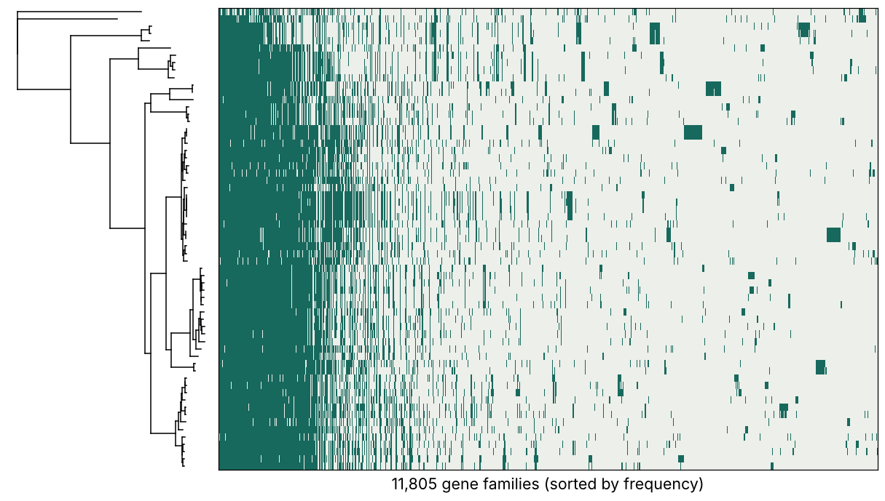

# Bacterial phylogenomics: from core-genome to gene-content variation

**TRR356 workshop for plant–microbe PhD students** · Tuesday 10 November 2026, online · Haim Ashkenazy, Department of Molecular Biology (Weigel), MPI for Biology Tübingen



*63 *Pseudomonas* genomes: species tree (left) and gene presence/absence of 11,805 variable gene families (right).*

## What this workshop is about
Two genomes can be 99.9% identical by ANI and still share only 70% of their genes. We look at bacteria through
two lenses, **sequence identity** and **gene content**, and ask how gene families are gained and lost along a tree,
which ones co-evolve, and which ones track a trait.

## Programme (Tuesday 10 November 2026, Berlin time)
| Time | Block | Content |
|---|---|---|
| 09:20 | Zoom opens | |
| 09:30 | **Part 1** (65 min) | Pangenome concept · ANI and skani · PopPUNK · gene-content similarity (PanGene-O-Meter) · Microbializer |
| 10:35 | Short break | |
| 10:50 | **Part 2** (70 min) | Phyletic patterns · gain and loss (GLOOME) · co-evolution (CoPAP) · gene-content GWAS (treeWAS, pyseer) |
| 12:00–14:30 | Lunch break and TRR seminar | |
| 14:30–16:30 | **Hands-on and consultation** | Your own genomes or the *Pseudomonas* set |

## Slides
The slides will be uploaded here after the workshop.
- Part 1: pangenomes, genome similarity and gene content
- Part 2: gain and loss, co-evolution and gene-content GWAS

## Two conda environments

| Environment | Used for | Create |
|---|---|---|
| `phylo-genomes` | steps 1-4: genome download, skani, PopPUNK, dRep, plots | `conda env create -f envs/phylo-genomes.yml` |
| `phylo-gwas` | steps 5-6: GLOOME / CoPAP, treeWAS, pyseer | `conda env create -f envs/phylo-gwas.yml` then install treeWAS (below) |

```bash
conda activate phylo-gwas
Rscript -e 'devtools::install_github("caitiecollins/treeWAS", build_vignettes=FALSE)'
gloome --help
```

The tools are split because GLOOME pins `numpy<2`, which can conflict with the packages in the genome environment.
Not tested together on a clean machine yet: run the `conda env create` lines before the workshop.

## Tools
| Tool | What for | Link |
|---|---|---|
| skani | fast ANI and aligned fraction | https://github.com/bluenote-1577/skani |
| PopPUNK | k-mer core/accessory distances, strain clusters | https://poppunk.net |
| PanGene-O-Meter | gene-content similarity | *(add link)* |
| Microbializer | pangenome, species tree, annotation (web server) | https://microbializer.tau.ac.il |
| GLOOME / CoPAP | gain and loss, co-evolution of gene families (web server) | https://gloome.tau.ac.il |
| treeWAS | gene-content association with a trait, tree-aware | https://github.com/caitiecollins/treeWAS |
| pyseer | bacterial GWAS (genes, unitigs, k-mers) | https://github.com/mgalardini/pyseer |
| dRep | genome dereplication by ANI | https://github.com/MrOlm/drep |

## Data
### `data/toy_example/`: simulated, 32 genomes × 60 gene families
Used in Part 2 to show every number: `toy2_tree.nwk` (tree), `toy2_PA_matrix.tsv` and `toy2_phyletic_pattern.fas`
(presence/absence), `toy2_trait.tsv` (fake pathogen/commensal trait), `toy2_truth.tsv` (which families are truly
linked, which are decoys).

### `data/pseudomonas/`: real, 63 *P. syringae* genomes plus a *P. fluorescens* outgroup
| File | Content |
|---|---|
| `accessions_63.txt`, `genome_set.tsv` | NCBI accessions and genome list |
| `pseudomonas_tree_for_gloome.nwk` | Microbializer species tree, rooted on the outgroup, support values removed |
| `pseudomonas_phyletic_pattern_ALL.fas` | all 26,703 orthogroups as 0/1: **use this for GLOOME** |
| `pseudomonas_phyletic_pattern.fas`, `*_positions.tsv` | the 11,805 variable families only (2–62 genomes), with their orthogroup names |

Genome sequences are not included: download them from NCBI with the accessions (see `scripts/ncbi_metadata.sh`).

## Hands-on in short
1. **Microbializer**: upload a zip of genomes (`scripts/make_microbializer_zip.sh`), set the outgroup, download tree and phyletic pattern.
2. **GLOOME / CoPAP**: upload the phyletic pattern and the tree. Choose **outgroup rooting** (`--rooting_method outgroup --leaf NAME` on the command line; the default is midpoint). GLOOME does not filter families: all positions are used to estimate rates; CoPAP tests only variable ones.
3. **treeWAS / pyseer**: associate gene presence/absence with a trait (`scripts/run_treewas.R`).

## Scripts
`make_microbializer_zip.sh` · `filter_phyletic_pattern.py` · `ncbi_metadata.sh` · `run_treewas.R` · `copap_modules.R` ·
`my_treewas_reimplementation.py` (a simplified teaching re-implementation, **not** the treeWAS package)

## References
- Ashkenazy and Weigel (2025) PanGene-O-Meter: intra-species diversity based on gene content. [bioRxiv preprint](https://doi.org/10.1101/2025.09.01.673544).
- Shimony et al. (2025) Nucleic Acids Res 53:W369 (Microbializer 2.0). [PubMed](https://pubmed.ncbi.nlm.nih.gov/40366021/)
- Cohen et al. (2010) Bioinformatics 26:2914 (GLOOME). [PubMed](https://pubmed.ncbi.nlm.nih.gov/?term=10.1093/bioinformatics/btq549); Cohen and Pupko (2010) Mol Biol Evol 27:703. [PubMed](https://pubmed.ncbi.nlm.nih.gov/19808865/)
- Shaw and Yu (2023) Nat Methods 20:1661 (skani). [PubMed](https://pubmed.ncbi.nlm.nih.gov/37735570/); Lees et al. (2019) Genome Res 29:304 (PopPUNK). [PubMed](https://pubmed.ncbi.nlm.nih.gov/30679308/); Olm et al. (2017) ISME J 11:2864 (dRep). [PubMed](https://pubmed.ncbi.nlm.nih.gov/28742071/)
- Collins and Didelot (2018) PLoS Comput Biol 14:e1005958 (treeWAS). [PubMed](https://pubmed.ncbi.nlm.nih.gov/29401456/); Lees et al. (2018) Bioinformatics 34:4310 (pyseer). [PubMed](https://pubmed.ncbi.nlm.nih.gov/30535304/)

## Citation and reuse
Please **cite the tools you use**, listed under References below (PanGene-O-Meter, Microbializer, GLOOME/CoPAP, skani, PopPUNK, dRep, treeWAS, pyseer). If you use this material in a course or talk, cite this workshop (Ashkenazy, TRR356 workshop "Bacterial phylogenomics", year, repository URL) and keep the credits below.
The slides and figures are CC BY 4.0, so attribution is required. I would also appreciate a short e-mail when you reuse them. This is a request, not a licence condition.
PanGene-O-Meter is described in a bioRxiv preprint (link to be added); the code is on GitHub (link to be added).

## Acknowledgements
Part 2 motivation slides (lateral gene transfer, gain and loss, the Markov model) are adapted from lecture material by Tal Pupko (Tel Aviv University); GLOOME and Microbializer are from his lab. Thanks to the Weigel department and TRR356.

## Licence
Code: MIT. Slides and figures: CC BY 4.0. See `LICENSE`.

## Contact
Haim Ashkenazy, haim.ashkenazy@tuebingen.mpg.de
